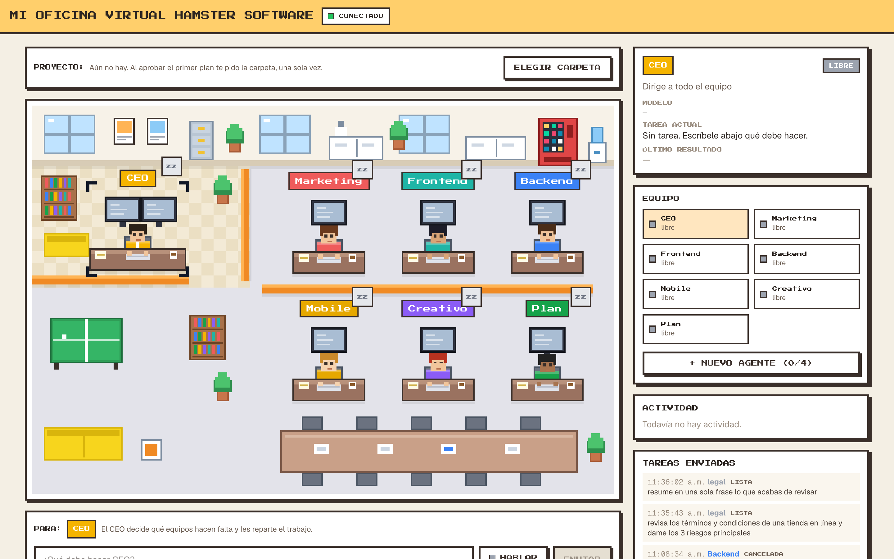
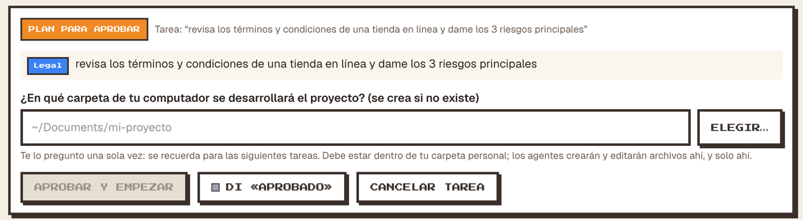
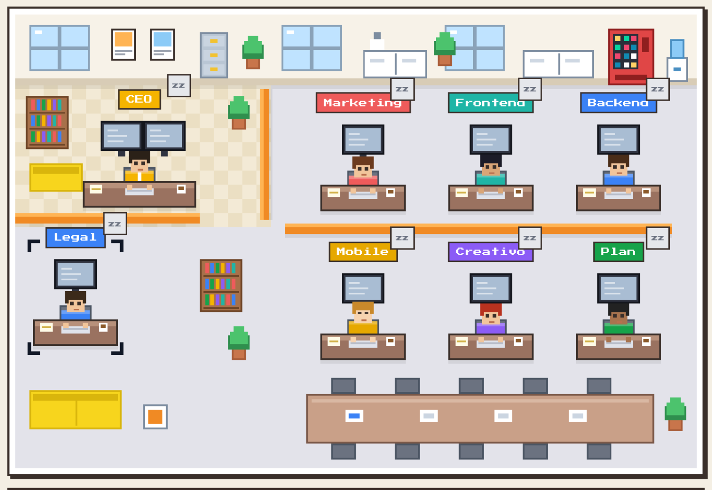
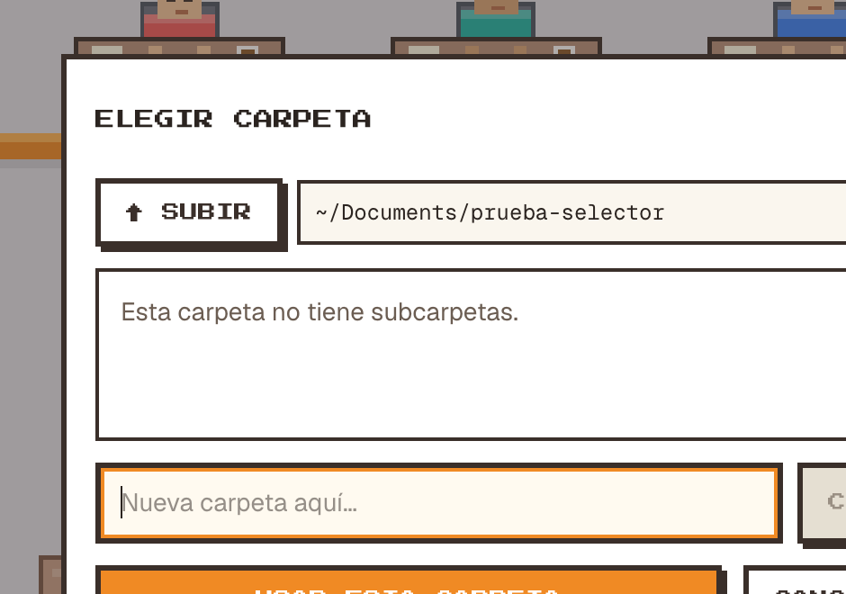
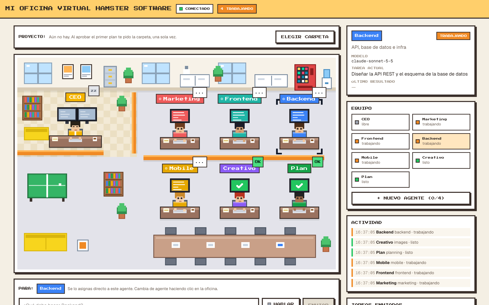
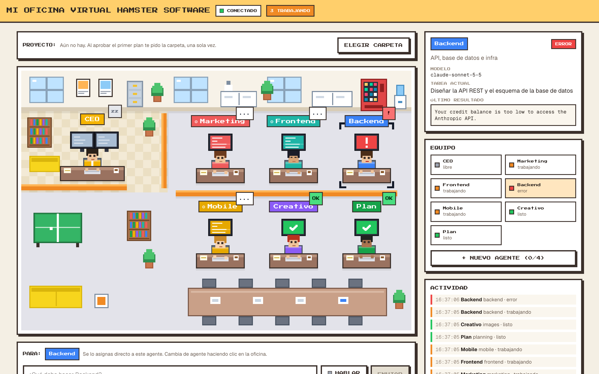
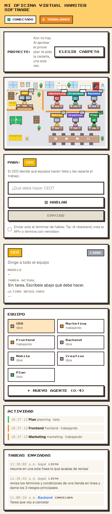

# Mi Oficina Virtual · Hamster Software

Una oficina virtual en pixel art, con estilo de videojuego en modo claro, para dirigir a un equipo de agentes de IA. Haces clic en un agente, le escribes qué debe hacer y lo ves trabajar en su escritorio en tiempo real.



## Qué puedes hacer

- **Ver la oficina en vivo.** Cada agente tiene su escritorio, su monitor y su personaje. El monitor cambia según lo que pase:
  - **Libre:** monitor apagado, globo `zz`.
  - **Trabajando:** líneas animadas en el monitor y un engranaje girando en la etiqueta, globo `...`.
  - **Listo:** monitor con un check verde, globo `OK`.
  - **Error:** monitor con `!` y globo `!`.
- **Darle una tarea a un agente concreto.** Haz clic en él (en la oficina o en la lista *Equipo*), escribe la tarea y pulsa **ENVIAR**. La tarea va directa a ese equipo.
- **Dejar que el CEO decida.** Con el CEO seleccionado, él elige qué equipos hacen falta y reparte el trabajo.
- **Aprobar el plan una sola vez.** Cuando envías la primera tarea de un proyecto, el CEO te muestra el plan (qué equipo hará qué) y te pide **una sola vez** la carpeta donde se desarrollará. Pulsas **APROBAR Y EMPEZAR** (o dices «aprobado») y arranca de inmediato: crea las carpetas, un `README.md` con el plan y un repositorio git, y los equipos empiezan a trabajar. Ya no hay más preguntas. La carpeta se recuerda: las tareas siguientes empiezan al instante. Arriba de la oficina ves el **PROYECTO** actual y puedes **CAMBIAR** la carpeta o empezar un **PROYECTO NUEVO**.
- **Elegir la carpeta sin escribirla.** **ELEGIR…** abre un explorador de tus carpetas: navegas, creas una nueva y la eliges. Si no quieres seguir con la tarea, **CANCELAR TAREA** la descarta. La tarjeta del plan sigue ahí aunque recargues la página.
- **Crear tus propios agentes.** En el panel *Equipo*, **+ NUEVO AGENTE**: le pones nombre, le cuentas qué debe hacer (también puedes dictarlo) y eliges un color. Se sienta en un escritorio nuevo de la oficina (hasta 4), puedes darle tareas directo y el CEO también le encarga trabajo. Se pueden borrar.
- **Hablarle al equipo.** El botón **HABLAR** usa el reconocimiento de voz del navegador (Chrome, Edge o Safari; el navegador pide permiso para el micrófono):
  - «**Backend, crea la API de pagos**» elige al agente y escribe la tarea. También entiende «dile al frontend que…» o «para el equipo de marketing…».
  - Terminar con «**envíalo**» (o marcar *Enviar solo al terminar de hablar*) la envía sin tocar nada.
  - Con un plan esperando, di «**aprobado**» (o «adelante», «dale», «empieza») para empezar. Si aún no elegiste carpeta, te lo recuerda.
- **Seguir todo en el panel de control.** Modelo en uso, tarea actual, último resultado, registro de actividad y tareas enviadas.
- **Usarlo desde el móvil.** El diseño se apila en una sola columna.









| Estado de error | Móvil |
| --- | --- |
|  |  |

## El equipo

| Agente | Qué hace |
| --- | --- |
| **CEO** | Recibe la instrucción, decide qué equipos intervienen y reparte subtareas. |
| **Marketing** | Estrategia, reels y analítica. |
| **Frontend** | Interfaz y experiencia de usuario con React. |
| **Backend** | API, base de datos e infraestructura. |
| **Mobile** | Apps para iOS y Android, con QA. |
| **Creativo** | Diseño gráfico y generación de imágenes. |
| **Plan** | Gestión de proyecto, roadmap y recursos. |

## Cómo funciona

```
Navegador (Next.js)  ──HTTP──▶  FastAPI  ──▶  CEO ──┐
        ▲                          │               │  MCP (fastmcp, en proceso)
        │                          └─ crew directo ┤
        └────────── WebSocket ◀── eventos ◀────────┴──▶  Crews: marketing · frontend · backend
                                                          mobile · images · planning
```

- **Frontend:** Next.js 16 y Tailwind v4. La oficina se dibuja en un `<canvas>` de 384×256 px escalado sin suavizado, con etiquetas y globos en HTML para que el texto se vea nítido.
- **Backend:** FastAPI. `POST /task` recibe la tarea y devuelve enseguida; el avance llega por el WebSocket `/ws`.
- **MCP entre equipos:** cada crew es una herramienta de un servidor [fastmcp](https://gofastmcp.com). El CEO y la asignación directa llaman a esas herramientas con un cliente en proceso (`dispatch_to_crew`).
- **CEO autónomo:** trabaja por rondas. Cada ronda decide qué equipos llamar, los lanza en paralelo por MCP y recibe sus resultados. Los equipos de las rondas siguientes reciben como contexto lo que ya entregaron los demás (por ejemplo, Planning antes que Backend y Frontend). Termina cuando considera que el trabajo está cubierto o tras `CEO_MAX_ROUNDS` rondas (3 por defecto). Las respuestas de los agentes se limitan a `AGENT_MAX_WORDS` palabras (400 por defecto) para que la coordinación sea rápida.
- **Proyecto recordado:** la carpeta aprobada se guarda en `backend/data/project.json` (ignorado por git). Mientras haya proyecto, el CEO no pregunta nada; el plan para aprobar solo aparece cuando no hay uno. Al aprobar se inicializa el proyecto sin pisar nada de lo que ya exista en la carpeta.
- **Agentes propios:** se guardan en `backend/data/agents.json`. Cada uno es una herramienta MCP genérica (`custom`) que corre con el texto que escribiste como rol, y el CEO los conoce y puede encargarles trabajo.
- **Carpeta del proyecto:** con `LLM_PROVIDER=claude-code`, los agentes crean y editan archivos reales dentro de la carpeta que elijas, cada equipo en su subcarpeta (`frontend/`, `backend/`, `mobile/`, `marketing/`, `images/` y `docs/` para Planning). Solo tienen herramientas de archivos (leer, escribir, editar, buscar), sin terminal, y no pueden escribir fuera de esa carpeta. La carpeta debe estar dentro de tu carpeta personal (`~`); se rechazan `~` mismo, las carpetas ocultas y `~/Library`. Con otros proveedores los agentes solo devuelven texto.
- **Enrutador de modelos:** según el agente usa Claude (críticos), GPT-4o (estándar) u Ollama local (tareas ligeras). Ver `backend/model_router/router.py`.
- **Historial persistente:** las tareas se guardan en `backend/data/history.json` (ignorado por git) y sobreviven a un reinicio del backend. Las que estaban en curso se marcan como *interrumpidas*. El plan pendiente de aprobar no sobrevive a un reinicio: hay que volver a enviar la tarea.
- **Seguridad local:** el backend solo acepta peticiones y WebSockets de `http://localhost:3000` y `http://127.0.0.1:3000`; otras páginas web no pueden leer lo que hacen tus agentes. Para usar otro origen, define `ALLOWED_ORIGINS` (separados por comas) en `backend/.env`.
- **Errores visibles:** si la llamada al modelo falla, el agente pasa a estado de error y muestra el mensaje real, en vez de quedarse "trabajando".

## Puesta en marcha

Necesitas Python 3 y Node.js. Para que las tareas den resultados reales, una API key de Anthropic con saldo. OpenAI y Ollama son opcionales.

**1. Backend** (puerto 8000)

```bash
cd backend
python3 -m venv .venv
source .venv/bin/activate
pip install -r requirements.txt
uvicorn main:app --reload --port 8000
```

**2. Frontend** (puerto 3000)

```bash
cd frontend
npm install
npm run dev
```

Abre <http://localhost:3000>.

**3. API keys**

Crea `backend/.env` (está en `.gitignore`) con tus keys y reinicia el backend:

```bash
ANTHROPIC_API_KEY=sk-ant-...
OPENAI_API_KEY=sk-...                  # opcional
OLLAMA_BASE_URL=http://localhost:11434 # opcional
DEFAULT_LOCAL_MODEL=llama3.2
DEFAULT_REMOTE_MODEL=claude-sonnet-5-5
```

**Sin créditos de API: usar tu sesión de Claude Code**

Si no tienes saldo en la API de Anthropic, puedes hacer que todos los agentes piensen a través del CLI de [Claude Code](https://claude.com/claude-code) con tu cuenta de Claude. Instálalo, inicia sesión con `claude` y añade esto a `backend/.env`:

```bash
LLM_PROVIDER=claude-code
CLAUDE_CODE_MODEL=sonnet   # modelo para los agentes que no son "claude-*"; opcional
```

Con eso las llamadas van por `claude -p` (sin herramientas, sin MCP y fuera del proyecto) y **ignoran** `ANTHROPIC_API_KEY`. Todos los agentes usan Claude, incluidos los que el enrutador asignaría a GPT-4o u Ollama. Reinicia el backend después de cambiarlo.

Si la cabecera dice **SIN CONEXIÓN**, el backend no está corriendo en el puerto 8000. Si un agente termina en error con un mensaje sobre saldo, tu cuenta de Anthropic necesita créditos.

## Usar los equipos desde Claude Code

El repositorio incluye un servidor MCP por stdio ([`.mcp.json`](.mcp.json)) que expone los seis equipos como herramientas con el nombre `ai-company-crews`. Abre el proyecto en una sesión nueva de Claude Code y las herramientas `marketing`, `frontend`, `backend`, `mobile`, `images` y `planning` quedan disponibles. Ajusta la ruta del intérprete de Python en `.mcp.json` si tu entorno virtual está en otro sitio.

## API

| Método | Ruta | Descripción |
| --- | --- | --- |
| `GET` | `/health` | Comprueba que el backend está vivo. |
| `GET` / `POST` | `/settings` | Consulta o guarda las API keys (sin pantalla en la interfaz; se editan en `backend/.env`). |
| `GET` | `/agents` | Estado actual de los equipos, según sus últimos eventos. |
| `GET` | `/history` | Tareas enviadas (persistentes). |
| `POST` | `/task` | `{ "instruction": "...", "crew": "backend" }`. Sin `crew`, lo gestiona el CEO. Si no hay proyecto, queda esperando tu aprobación; si lo hay, empieza al instante. |
| `GET` / `POST` | `/folders` | Explorador de carpetas (solo dentro de `~`): lista subcarpetas, o crea una nueva con `{ "parent": "...", "name": "..." }`. |
| `GET` / `POST` / `DELETE` | `/project` | Carpeta del proyecto actual: consultarla, cambiarla (`{ "folder": "..." }`) u olvidarla. |
| `GET` / `POST` | `/custom-agents` | Lista o crea agentes propios (`{ "label", "role", "color" }`). |
| `DELETE` | `/custom-agents/{key}` | Borra un agente propio. |
| `GET` | `/pending` | Tareas que esperan aprobación, con su plan. |
| `POST` | `/task/{id}/cancel` | Cancela una tarea que espera aprobación. |
| `POST` | `/task/{id}/answers` | Aprueba el plan: `{ "answers": { "folder": "~/mi-proyecto" } }`. Valida la carpeta, la crea, inicializa el proyecto y arranca. |
| `WS` | `/ws` | Eventos de los agentes en tiempo real y mensajes `questions` (con el plan) / `questions_resolved`. |

## Estructura

```
backend/
  main.py              API, WebSocket y asignación de tareas
  orchestrator/        agente CEO
  crews/               los seis equipos
  mcp_servers/         servidor MCP (en proceso y stdio)
  model_router/        qué modelo usa cada agente
  tests/
frontend/
  app/page.tsx         la oficina y la barra de comandos
  components/          PixelOffice, ControlPanel
  lib/office.ts        posiciones y colores de los agentes
  hooks/useWebSocket.ts
docs/                  diseño, plan e imágenes de este README
```

## Pruebas

```bash
cd frontend && npm test          # intérprete de comandos de voz
cd backend && source .venv/bin/activate && pytest
```

## Licencia

Sin licencia definida todavía.
